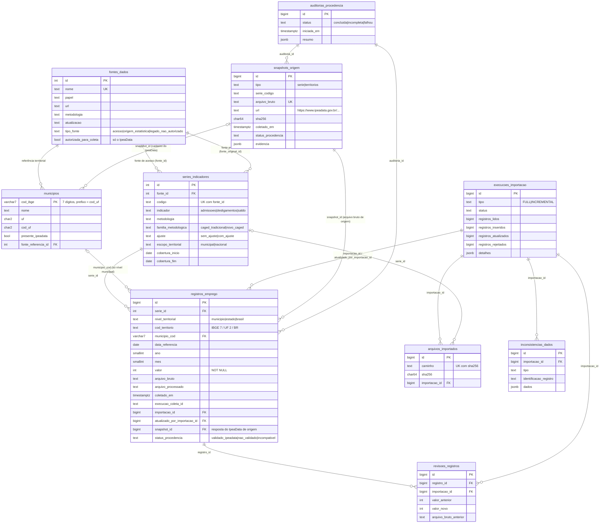

# Modelagem do banco PostgreSQL

Banco relacional do dashboard: cadastros (fontes, municípios, séries), observações históricas
e rastreabilidade das importações. A estrutura é criada pela migração Alembic
[`0001`](../database/migrations/versions/20261025_0001_esquema_inicial.py), espelhada pelos
modelos SQLAlchemy em [`banco/modelos.py`](../banco/modelos.py) (`alembic check` confere que
não divergem).

## Granularidade real dos dados

A auditoria dos arquivos da etapa 1.5 mostrou:

- Em cada série há **no máximo uma observação por nível territorial × território × mês**
  (217 por mês no nível municipal; 1 no estadual; 1 no nacional).
- As séries municipais (`ADMISNC`, `DESLIGNC`) trazem também o **total da UF** e o **total
  Brasil**; as séries de referência (`CAGED12_*`) são **só nacionais**.
- Saldos nacionais podem ser negativos; contagens chegam a ~2,6 milhões por mês.
- O código territorial original do Brasil é `0` nas séries regionais e vazio nas nacionais.

Por isso a chave natural de uma observação é **(série, nível territorial, território,
competência)**. Município + mês + indicador não bastaria: o mesmo mês tem valores municipais,
estaduais e nacionais da mesma série, e indicadores iguais existem em metodologias diferentes.

## Diagrama entidade-relacionamento

## Tabelas

| Tabela | Conteúdo | Chave |
|---|---|---|
| `fontes_dados` | IpeaData (**única fonte de acesso autorizada**), MTE/Caged (origem estatística, nunca acessada) e, como legado, IBGE (`legado_nao_autorizado`) | `id`; `nome` único |
| `municipios` | Os 217 municípios da lista oficial do IBGE, mais atributos do IpeaData (capital, área, presença no cadastro) | `cod_ibge` |
| `series_indicadores` | 11 séries: indicador, metodologia, família, ajuste, escopo, periodicidade, unidade, cobertura | `id`; `(fonte_id, codigo)` único |
| `registros_emprego` | Observações publicadas (fato), com origem completa | `id`; chave natural única |
| `revisoes_registros` | Valor anterior de cada observação revisada pela fonte | `id` |
| `execucoes_importacao` | Cada importação FULL/INCREMENTAL com contadores e erros | `id` |
| `arquivos_importados` | Arquivos processados já carregados (base do incremental e da retomada) | `(caminho, sha256)` único |
| `inconsistencias_dados` | Registros rejeitados, arquivos com problema de integridade, observações ausentes na origem | `id` |
| `snapshots_origem` | Resposta do IpeaData que originou observações: URL, SHA-256, horário, resultado e evidência da verificação | `id`; `arquivo_bruto` único |
| `auditorias_procedencia` | Cada execução da auditoria de procedência | `id` |

Além do pedido original, três tabelas se justificaram pelo esquema real:
`revisoes_registros` (revisões controladas sem perder o valor anterior nem sua origem),
`arquivos_importados` (saber o que é novo no incremental e retomar importações interrompidas)
e o nível territorial explícito em `registros_emprego` (os dados têm UF e Brasil além de municípios).

### Procedência e views de dados validados

Toda observação, série e município tem `status_procedencia`: `validado_ipeadata`, `nao_validado` (origem ainda não
comprovada) ou `incompativel` (comprovadamente de fonte não autorizada). A auditoria
([auditoria_origem_ipeadata.md](auditoria_origem_ipeadata.md)) é a única que marca `validado_ipeadata`, depois de comparar
com o arquivo bruto preservado e com a resposta oficial do IpeaData.

| View | Conteúdo |
|---|---|
| `vw_registros_validados` | Observações com status validado **e** série validada, fonte autorizada, snapshot validado e, no nível municipal, município validado |
| `vw_municipios_validados` | Municípios validados, de fonte autorizada, com snapshot do IpeaData validado |
| `vw_movimentacao_mensal` | Admissões, desligamentos e saldo, calculados **sobre `vw_registros_validados`** |

**Todas as consultas analíticas leem apenas essas views.** Dados não validados ou incompatíveis permanecem nas tabelas
(nada é apagado), mas não aparecem nas consultas. Importar um valor revisado devolve aquele registro a `nao_validado`
até nova auditoria.

### View `vw_movimentacao_mensal`

Uma linha por território × mês × metodologia, com admissões, desligamentos e saldo lado a lado.
Agrupa por **fonte + metodologia + escopo**, então nunca combina CAGED tradicional com Novo
Caged, nem séries com e sem ajuste. A restrição única
`(fonte_id, indicador, metodologia, escopo_territorial)` garante no máximo uma série de cada
indicador por grupo. O saldo fica `NULL` se faltar um dos dois valores. É uma view comum (não
materializada); ver [Desempenho](#desempenho).

## Integridade

Regras de procedência (migração `0002`):

| Regra | Implementação |
|---|---|
| Só fonte de acesso pode ser autorizada | `CHECK autorizada_para_coleta → tipo_fonte = 'acesso'` |
| Série ou município de fonte não autorizada é recusado | Gatilho `trg_fonte_autorizada` |
| "Validado" exige origem comprovada | `CHECK status = 'validado_ipeadata' → snapshot_id e data da verificação` (registros, municípios); série validada exige os metadados do IpeaData |
| URL do snapshot é do IpeaData | `CHECK url ~ '^https://www\.ipeadata\.gov\.br/api/odata4/'` |
| Observação aponta para snapshot da própria série | Gatilho `trg_registro_snapshot_coerente` |
| Hash do arquivo bruto registrado | `sha256` com `CHECK` de 64 hexadecimais |

Regras de dados:

| Regra | Implementação |
|---|---|
| Código IBGE válido | `CHECK cod_ibge ~ '^[0-9]{7}$'` e `left(cod_ibge, 2) = cod_uf` |
| Observação municipal pertence a um município cadastrado | FK `municipio_cod → municipios` |
| Estadual/nacional nunca vira municipal | `CHECK`: `municipio_cod` só no nível `municipio` e igual a `cod_territorio`; UF = 2 dígitos; Brasil = `BR` |
| Sem duplicatas | `UNIQUE (serie_id, nivel_territorial, cod_territorio, data_referencia)` |
| Ausência não vira zero | `valor NOT NULL`: uma observação ausente simplesmente não tem linha |
| Competência coerente | `CHECK` dia = 1, `ano` e `mes` iguais aos da data |
| Metodologias distinguíveis | `metodologia`, `familia_metodologica`, `ajuste` com `CHECK` de domínio |
| Rastreabilidade | `arquivo_bruto`, `arquivo_processado`, `coletado_em`, `serie_atualizada_em`, `execucao_coleta_id`, FKs para a importação que criou e a que atualizou |
| Fuso horário | Todas as datas-hora são `timestamptz`; servidor em UTC |

O sinal do valor **não** é restringido no banco: saldos são negativos por natureza e
retificações da fonte não devem ser bloqueadas por regra de esquema. A regra "contagem não
pode ser negativa" fica na validação do importador, que rejeita e registra o caso.

Tipos: `valor` é `INTEGER`, porque o maior valor mensal observado (~2,6 milhões) está muito
abaixo do limite de 2,1 bilhões, e as somas do SQL já resultam em `BIGINT`. Contadores e IDs
de tabelas de crescimento contínuo são `BIGINT`. `NUMERIC(12,2)` guarda a área dos
municípios com precisão exata.

## Índices

| Índice | Atende |
|---|---|
| `uq_registros_emprego_chave_natural` (série, nível, território, data) | Upsert (`ON CONFLICT`), série de um território |
| `ix_registros_emprego_municipio_serie_data` | Histórico de um município (página do município no dashboard) |
| `ix_registros_emprego_serie_nivel_data` | Rankings, totais e filtros por período (todos os municípios de uma série num intervalo) |
| `ix_registros_emprego_importacao_id`, `..._atualizado_por_importacao_id` | Auditoria por importação e FKs |
| `ix_municipios_uf_nome` | Listagem de municípios por UF em ordem alfabética |
| Índices em FKs de `revisoes_registros`, `arquivos_importados`, `inconsistencias_dados` | Joins de auditoria |

## Estratégia de importação

`python -m scripts.importar_postgresql --tipo full|incremental` ([`banco/importacao.py`](../banco/importacao.py)):

1. **Pré-condições:** coleta sem execução em andamento; validação da etapa 1 não reprovada;
   trava `pg_advisory_lock` (uma importação por vez).
2. **Cadastros** por upsert (fontes, 217 municípios conferidos com o total esperado, séries).
3. **Por arquivo do `manifesto.json`** (SHA-256 em disco igual ao do manifesto; senão o
   arquivo é ignorado e registrado), **em uma transação**:
   leitura em lotes (`IMPORTACAO_TAMANHO_LOTE`) → validação vetorizada (motivo da rejeição
   registrado em `inconsistencias_dados`) → `COPY` para tabela temporária → `ANALYZE` →
   chaves repetidas no arquivo saem todas → revisões registradas →
   `INSERT ... ON CONFLICT DO UPDATE ... WHERE valor IS DISTINCT FROM EXCLUDED.valor` →
   observações do banco ausentes no arquivo são registradas (nunca apagadas) → arquivo
   gravado em `arquivos_importados` → contadores da execução.
4. Uma falha desfaz só o arquivo em curso; a execução fica `falhou` com a mensagem, e a
   próxima importação incremental continua dos arquivos ainda não confirmados.

Memória: só um lote de leitura e as linhas do arquivo atual passam pelo Python. O conjunto
de comparação fica no PostgreSQL (tabela temporária).

## Estratégia de atualização incremental

- A coleta incremental (etapa 1.5) regrava só as partições afetadas e atualiza o manifesto.
- A importação incremental carrega só arquivos cujo `(caminho, sha256)` ainda não está em
  `arquivos_importados`.
- Observação nova → `INSERT`. Valor revisado → `UPDATE`, com o valor anterior, o arquivo
  bruto e a coleta anteriores guardados em `revisoes_registros`. Valor igual → nada muda (a
  proveniência original é mantida).
- Repetir a mesma importação não altera nada (idempotente, verificado em teste e com dados
  reais).

## Desempenho

Medido com `EXPLAIN ANALYZE` (`python -m scripts.verificar_banco`; resultados em
[relatorio_etapa2.md](relatorio_etapa2.md)): as consultas do dashboard usam os índices da
tabela de fatos e rodam em milissegundos. Com ~36 mil observações:

- **Particionamento:** desnecessário. Ganha relevância com dezenas de milhões de linhas, e a
  base cresce ~434 linhas por mês (217 municípios × 2 séries).
- **Materialized views:** desnecessárias com tempos nessa faixa. Se a API passar a fazer
  agregações pesadas e repetidas, `vw_movimentacao_mensal` é a candidata natural, com
  `REFRESH` após cada importação.
- **Paginação futura (API):** por chave (*keyset*) sobre `(data_referencia, cod_territorio)` ou
  `(nome)` em municípios, usando os índices existentes; evitar `OFFSET` alto.

## Taxas percentuais

Não há taxas no banco. Para taxa de admissão, de desligamento ou de rotatividade seria preciso
um **estoque de empregos formais por município** compatível com o Novo Caged (estoque de
referência do MTE ou RAIS), que não existe no IpeaData. Ver
[investigacao_ipeadata.md](investigacao_ipeadata.md).
